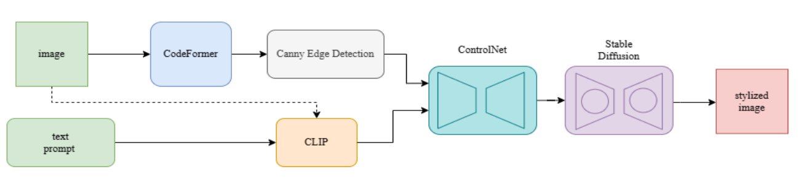

<div align="center">

# ArtifyAI
### Text-Guided Artistic Image Enhancement and Stylization
### تحسين الصور وتحويلها إلى أنماط فنية بتوجيه نصي


👥 **Team project** · Course: Advanced Artificial Intelligence · Princess Nourah bint Abdulrahman University

👥 **مشروع جماعي** · المقرر: الذكاء الاصطناعي المتقدم · جامعة الأميرة نورة بنت عبدالرحمن

[English](#english) · [العربية](#arabic)

</div>

---

<a id="english"></a>

## Overview

Millions of photos are taken every day, yet many of them, from old family portraits to low-resolution phone shots, lose their value to noise, blur and age. Existing tools either **restore** an image or apply a **creative filter**, rarely both.

**ArtifyAI** brings the two together in one intelligent pipeline. It first **restores** a degraded photo with a state-of-the-art face restoration model, then **transforms** it into an artistic style described in plain language, while preserving the structure and identity of the original image. It can even **recommend** the most suitable style by analyzing the image content.

## Key Features

- ✨ **High-fidelity restoration**: CodeFormer restores facial details and overall clarity, with Real-ESRGAN background upsampling.
- 🧠 **Smart style recommendation**: CLIP analyzes the image and ranks the most suitable artistic styles with confidence scores.
- 🎨 **Structure-preserving stylization**: Canny edges guide ControlNet so Stable Diffusion changes the style, not the subject.
- ✍️ **Text-driven control**: choose a preset style (Cartoon, Anime, Realistic, Surreal) or write any custom prompt, with no reference image needed.
- 📏 **Objective quality evaluation**: every enhancement is measured with PSNR, SSIM and LPIPS.
- ⚡ **No training required**: a fully inference-based design built on pre-trained models, so it adapts to any input image instantly.

## How It Works



| Stage | Model | Role |
|---|---|---|
| 1. Enhancement | **CodeFormer** + Real-ESRGAN | Restores degraded faces and upsamples the background |
| 2. Evaluation | **PSNR · SSIM · LPIPS** | Quantifies the enhancement objectively |
| 3. Style recommendation | **CLIP** (ViT-L/14) | Matches the image content to the best-fitting artistic styles |
| 4. Structure extraction | **Canny edge detection** | Builds a structural "blueprint" of the image |
| 5. Stylization | **Stable Diffusion v1.5 + ControlNet (Canny)** | Generates the stylized image guided by the edges and the text prompt |

During development, the team first evaluated GFPGAN for restoration, then switched to CodeFormer for better compatibility with the pipeline and more consistent results across varied inputs.

## Results

| Metric | Measures | Ideal | Result |
|---|---|---|---|
| **PSNR** | Pixel-level fidelity | Higher is better | **25.59 dB** |
| **SSIM** | Structural similarity | Closer to 1.0 | **0.8445** |
| **LPIPS** | Perceptual similarity | Closer to 0.0 | **0.2856** |

The pipeline preserved the core identity and composition of each input image while producing visually compelling, stylistically relevant outputs.

## Repository Structure

```
├── notebooks/
│   └── artifyai_pipeline.ipynb   # full pipeline: enhancement → evaluation → CLIP → ControlNet stylization
├── docs/
│   └── artifyai_report.pdf       # project report
├── assets/
│   └── system_flow.png
├── requirements.txt
└── README.md
```

## How to Run

Open `notebooks/artifyai_pipeline.ipynb` in **Google Colab** with a GPU runtime and run the cells in order. The notebook installs the dependencies, sets up CodeFormer, then asks you to upload an image and choose a style (or let the AI recommend one).

## Future Work

- Refine the CLIP-based style recommendation engine
- Support real-time transformations
- Reintroduce motion: animating still images

## Team

Ghaida Abdullah Alsabti · Ghaida Aziz Alanazi · Hessah Mohammed AlMujally · **Wasan Mahdi Alomar**

📄 Full details in the [project report](docs/artifyai_report.pdf). Team repository: [ghaidaaziz1/ArtifyAI-](https://github.com/ghaidaaziz1/ArtifyAI-)

---

<a id="arabic"></a>
<div dir="rtl">

## نظرة عامة

تُلتقط ملايين الصور كل يوم، لكن كثيراً منها، من صور العائلة القديمة إلى صور الجوال منخفضة الدقة، يفقد قيمته بسبب التشويش وضعف الوضوح وقِدم الصورة. والأدوات المتاحة غالباً إما **تحسّن** الصورة أو تطبّق عليها **فلتراً إبداعياً**، ونادراً ما تجمع بين الاثنين.

**ArtifyAI** يجمعهما في مسار ذكي واحد: يبدأ **بترميم** الصورة باستخدام نموذج متقدم لاستعادة ملامح الوجه، ثم **يحوّلها** إلى نمط فني يصفه المستخدم بلغة طبيعية، مع الحفاظ على بنية الصورة الأصلية وهوية صاحبها. ويستطيع أيضاً **اقتراح** النمط الأنسب بعد تحليل محتوى الصورة.

## أبرز المميزات

- ✨ **ترميم عالي الدقة**: نموذج CodeFormer يستعيد تفاصيل الوجه ووضوح الصورة، مع تحسين الخلفية بنموذج Real-ESRGAN.
- 🧠 **اقتراح ذكي للأنماط**: نموذج CLIP يحلل الصورة ويرتّب الأنماط الفنية الأنسب لها مع نسبة الثقة.
- 🎨 **تحويل فني يحافظ على البنية**: حواف الصورة المستخرجة بخوارزمية Canny توجّه ControlNet، فيتغيّر النمط ويبقى المحتوى.
- ✍️ **تحكم بالنص**: اختيار نمط جاهز (كرتوني، أنمي، واقعي، سريالي) أو كتابة أي وصف مخصص، دون الحاجة إلى صورة مرجعية.
- 📏 **تقييم موضوعي للجودة**: قياس كل تحسين بمقاييس PSNR و SSIM و LPIPS.
- ⚡ **لا يحتاج إلى تدريب**: مبني بالكامل على نماذج مدرّبة مسبقاً، فيتكيّف مع أي صورة مباشرة.

## النتائج

- **PSNR**: ‏25.59 dB
- **SSIM**: ‏0.8445
- **LPIPS**: ‏0.2856

حافظ النظام على هوية الصورة الأصلية وتكوينها، مع إنتاج مخرجات فنية جذابة ومناسبة للنمط المطلوب.

## التقنيات المستخدمة

Python · PyTorch · Stable Diffusion · ControlNet · CodeFormer · CLIP · OpenCV · Google Colab

## الفريق

Ghaida Abdullah Alsabti · Ghaida Aziz Alanazi · Hessah Mohammed AlMujally · **Wasan Mahdi Alomar**

📄 التفاصيل الكاملة في [تقرير المشروع](docs/artifyai_report.pdf).

</div>
